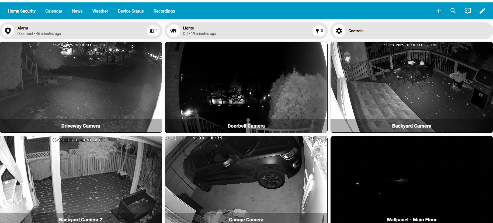
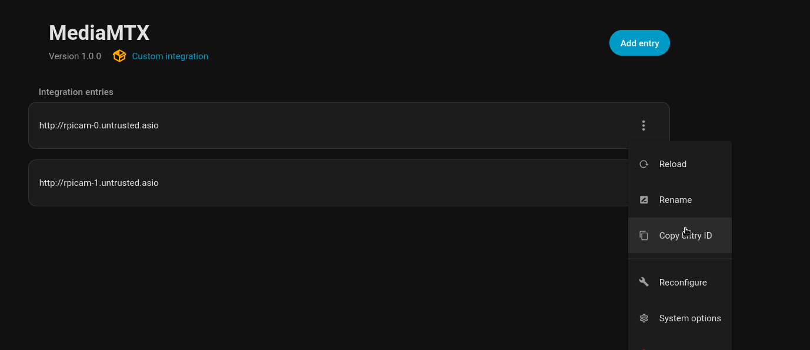

# Video Source Integration for Home Assistant

This integration provides a WebRTC Video component for MediaMTX or go2rtc within Home Assistant.

## Features

- A WebRTC video component for Home Assistant, backed by MediaMTX or go2rtc (your own instance, or Home Assistant's built-in go2rtc)
- Choice of authentication to your MediaMTX / go2rtc server:
  - Via Home Assistant before being proxied to your MediaMTX / go2rtc instance.
  - `BASIC` authentication proxied via Home Assistant
  - None
- Built for "wife friendly" use. Tap to go full screen, tap again to return.
- Ideal for Kiosks. When not full screen, live video will not keep your screen alive, so your Kiosk can sleep properly.
- Support for 'activities' to call attention to people/objects in video
- Support for 'events' which can automatically set video to full screen
- Support for multiple servers, in any mix of MediaMTX and go2rtc (add the integration once per server)
- Press-and-hold two-way audio (go2rtc only)



## Installation (via HACS)

1. Go to HACS → Integrations → ⋮ → Custom repositories.
2. Add:

https://github.com/JoeHogan/ha-video-source

with category **Integration**.
3. Install **Video Source Integration**.
4. Restart Home Assistant.
5. Add the integration via *Settings → Devices & Services → Add Integration → Video Source*.
6. Follow the setup wizard (see below). Repeat for each server you want to use.

## Configuration

Setting up the integration is a short wizard. You can add the integration as many times as you like, once per server.

**Step 1 - choose your video source:** *MediaMTX* or *go2rtc*.

**Step 2 - configure it:**

- **MediaMTX:** enter your MediaMTX service URL (e.g. `http://192.168.1.X:8899`) and how Home Assistant should authenticate with it.
- **go2rtc:** enter the URL of your own go2rtc instance (e.g. `http://192.168.1.X:1984`), then choose how to authenticate with it. **Leave the URL blank to use Home Assistant's built-in go2rtc** (nothing else to configure).

Which server a card uses is decided by the integration entry it points to (see `entry_id` below), not by the card itself.

| Source | What `resource` is |
| --- | --- |
| MediaMTX | the name of the stream/path in MediaMTX |
| go2rtc (your own instance) | the stream name from your go2rtc configuration |
| go2rtc (Home Assistant built-in) | a camera entity, e.g. `camera.driveway_camera` |

> Your own go2rtc instance is reached by your browser over WebRTC on the local network, with signaling proxied through Home Assistant. Remote viewers need a way to reach go2rtc's WebRTC port (VPN, or port forwarding / TURN).
## Card Options

### type
    Required: custom:video-source-card

### resource
    Required: the name of your camera stream. For MediaMTX / your own go2rtc this is the stream name; for Home Assistant's built-in go2rtc it is a camera entity id (e.g. camera.driveway_camera).

### entry_id
    Optional: ID of the integration entry (MediaMTX or go2rtc server) to use. Copy paste from settings page. If omitted, the first configured entry is used, so set this whenever you have more than one entry.



### name
    Optional: the name you want to appear under the video

### activity
    Optional: sensor events used to highlight camera activity

    - entity: the sensor to track
    - state: the state of the sensor used to determine if an activity is happening
    - name: The name of the tag that will appear when the activity is occurring

### event
    Optional: sensor events used to automatically set video to full screen

    - entity: the sensor to track
    - state: the state of the sensor used to determine if an event is happening
    - timeoutSeconds: how long to wait to return the video to normal size, assuming the event is ongoing. This is optional; omitting this keeps the video at full screen until manually closed.

### preview
    Advanced/Optional: Show preview images to reduce memory. See advanced configuration information. 

### two_way_audio
    Optional (default false): show a press-and-hold microphone button in full screen that sends your microphone audio to the camera speaker. Only available when the card's integration entry is go2rtc (not MediaMTX), requires a camera that supports an audio backchannel, and requires Home Assistant to be accessed over HTTPS (browsers block microphone access otherwise). Pressing the button unmutes the video if it is muted; releasing it stops sending audio but does not re-mute.

## Card Usage Examples

### Basic

```
    - type: custom:video-source-card
      entry_id: 01KCXWDR7C4DVVSAHFW7MQGWPT
      resource: driveway_camera
      name: Driveway Camera
```

### Activity and Events

```
  - type: custom:video-source-card
    entry_id: 01KCXWDR7C4DVVSAHFW7MQGWPT
    resource: driveway_camera
    name: Driveway Camera
    preview: true
    activity:
        - entity: binary_sensor.driveway_primary_zone_person_occupancy
          state: 'on'
          name: Person
        - entity: binary_sensor.driveway_secondary_zone_car_occupancy
          state: 'on'
          name: Car
    event:
        entity: binary_sensor.driveway_secondary_zone_car_occupancy
        state: 'on'
        timeoutSeconds: 60
```

## Advanced Configuration

You can configure MediaMTX to take snapshots of each camera at intervals (ie: every 3 seconds), and this integration can show those snapshots at an interval until you click on the video to go full screen, at which point the WebRTC stream begins. This is useful for displaying many camera streams on a single dashboard where you have memory constraints (ie: Fire Tablet). See the 'examples/image_preview' folder for instructions on how to configure MediaMTX.

The important part is that requests are made to the same url/port as MediaMTX, but include /img/ in the path. You may use Nginx or similar to properly route requests for /img/ to your image folder while all other paths route though to MediaMTX.

Once configured, you may simply add the 'preview' property:

```
  - type: custom:video-source-card
    entry_id: 01KCXWDR7C4DVVSAHFW7MQGWPT
    resource: driveway_camera
    name: Driveway Camera
    preview: true
```

## Remote Access

You can view cameras remotely with the Home Assistant mobile app if connected back to your home network with a VPN such as WireGuard.
